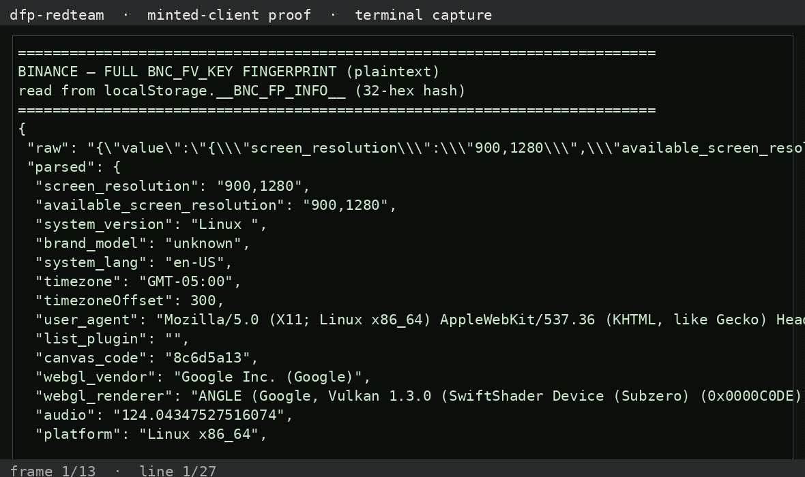

# dfp-redteam-binance — Binance security stack + fingerprint

Full details in `BINANCE_ASSESSMENT_2026_10_31.md`.

---

## What we observed (the shipped payload)

**The in-house `BNC_FV_KEY` fingerprint is read in full and tamper-proven** —
it ships as a 32-hex hash in `localStorage.__BNC_FP_INFO__`
(`dynamic-fingerprint.4a1db346.js`: canvas/webgl/audio/fonts/hardware →
hash). Rewriting any signal **flips the hash** (tamper-proven). Around it:

- **AWS WAF JS challenge** (`aws-waf-token`) at the edge.
- Themis feature-flags + HMAC/2FA API auth.
- The fingerprint is a **correlation signal, not a proof** — the WAF stops
  launches, API auth stops unauthorized actions.

## Status

- 🟢 Read payload: `__BNC_FP_INFO__` fingerprint read in full plaintext
- 🟢 Tamper with payload: signal rewrite flips the hash (proven)
- 🟡 Mint token: can mint the fingerprint hash, but not the session/WAF token

## Demo video — the fingerprint in plaintext

**Watch the capture** (terminal capture of `scripts/demo-binance.py` printing
the full `BNC_FV_KEY` fingerprint — screen, UA, language, timezone, canvas
hash — read from `localStorage.__BNC_FP_INFO__`, no truncation):



<video controls preload="metadata" width="720"><source src="assets/videos/full-payload-demo.mp4" type="video/mp4"></video>

Reproduce it yourself:

```bash
python3 scripts/demo-binance.py artifacts/fp-info.json
```

Full payload artifact: [fp-info.json](artifacts/fp-info.json) ·
[fingerprint-state.json](artifacts/fingerprint-state.json)
[Download the mp4](https://raw.githubusercontent.com/JWally/dfp-redteam-binance/main/assets/videos/full-payload-demo.mp4)

## Files

- writeup: `BINANCE_ASSESSMENT_2026_10_31.md`
- scripts/artifacts per the writeup
